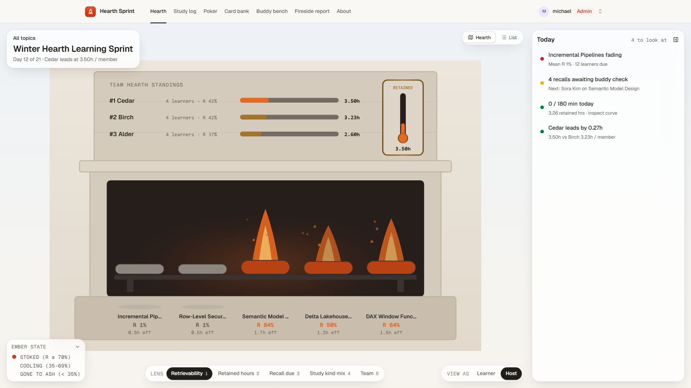

# Hearth Sprint

Score what people retain, not what they sit through: log weighted study sessions, take short spaced-recall checks confirmed by a teammate, and track your team's retained hours on a stone hearth.




## This repository

```text
apps/hearth-sprint/   the app: React + Vite frontend, Rayfin data model (rayfin/), tests, demo walkthrough
shared/         shared package (@x10/shared): data store, sign-in runtime, UI kit, charts
tools/          deploy, seed, SQL and secrets-check scripts
```

Quick start (no Fabric tenant needed, runs in demo mode with sample data):

```bash
npm install
npm run dev
```

## The problem & model

Traditional learning-hours challenges reward sitting through videos at 2× speed. A fortnight later nobody can answer a question about what they studied, and the leaderboard measures stamina instead of learning.

Hearth Sprint applies a simplified exponential forgetting curve (`R = exp(-t / S)`) inspired by spaced-repetition research (Ebbinghaus / FSRS). Study sessions build effective hours (weighted by active engagement: read 0.6×, watch 0.6×, build 1.0×, teach 1.4×), and teammate-confirmed recall checks multiply memory stability `S` so retained hours stay warm.

## What it looks like

The centrepiece is **the hearth**: a stone fireplace at dusk where each topic is a log on the wrought-iron grate. Log thickness encodes effective hours, flame height and ember glow encode retrievability `R`, neglected topics fade to grey ash with a pale ash line on the hearthstone, and a brass thermometer on the chimney breast tracks team retained hours per member.

- **Lenses:** Retrievability (`1`), Retained hours (`2`), Recall due (`3`), Study kind mix (`4`), Team (`5`).
- **Tools:** Study log, Poker (5-card recall check), Card bank, Buddy bench (teammate confirmation), Fireside report (printable).
- **Fallbacks:** Complete SVG fireplace with static glow under `?nowebgl` or `prefers-reduced-motion: reduce` (sparks stop, glow stays), plus an accessible List view with the exact same `R` values.

## Prerequisites

- Microsoft Fabric with the Fabric Apps workload enabled
- A Fabric workspace on a capacity with Edit permission
- Node.js 20+

## Run locally

```bash
npm install
cd apps/hearth-sprint
npm run dev        # demo mode with deterministic seed & persona switcher (port 5299)
npm run dev:fabric # connected to Fabric
```

## Deploy

```bash
cd apps/hearth-sprint
npx rayfin up --workspace-id <workspace-id>
```

## Seed

```bash
cd apps/hearth-sprint
npm run seed:fabric -- --admin-email you@org.com
```

The first persona in `src/app.config.ts` (`Maren Solberg`) is the Sprint Host (admin). In Fabric mode, assign admin access to the host account when seeding.

## How it works

| Entity | Purpose | Row-level security |
| --- | --- | --- |
| `Sprint` | 21-day sprint window | `claims.sub.eq(item.hostSub)` on write; `authenticated` read |
| `Topic` | Sprint topics | `claims.sub.eq(item.hostSub)` on write; `authenticated` read |
| `Learner` | Enrolled learners & teams | `claims.sub.eq(item.personSub)` on write; `authenticated` read |
| `Card` | Recall prompt/answer bank | `claims.sub.eq(item.authorSub)` on write; `authenticated` read |
| `Study` | Weighted study sessions | `claims.sub.eq(item.learnerSub)` on write; `authenticated` read |
| `Recall` | 5-card recall attempts | `claims.sub.eq(item.learnerSub)` on write; `authenticated` read |
| `Confirm` | Teammate confirmations | `claims.sub.eq(item.confirmerSub)` on write; `authenticated` read |

Pure rules in `src/domain/rules.ts` compute `R`, stability `S`, effective hours (10-minute minimum, 180 min/day cap, 3 effective hours/topic cap), size-fair team scores (mean per member), and deterministic 5-card draws. Separation of duties (no self-confirmation) and the 5 confirms/day limit are enforced in `src/domain/sprint.ts`.

## Known limits

- Separation of duties (`confirmerSub !== recall.learnerSub`) and the daily 5-confirmation cap are enforced in domain logic rather than database RLS policies because Rayfin RLS policies evaluate single-row predicates.
- The forgetting curve is a simplified exponential model intended for team learning sprints, not formal educational certification.

## Later

- Team-to-team friendly sprint brackets and exportable card decks.

## Gallery

**Title:** 12 Days of Fabric Apps: Day 7.7 – Hearth Sprint

**Blurb:** Stop rewarding 2× video marathons. Hearth Sprint turns team learning into a spaced-repetition sprint built on Fabric Apps for AI at Work. Log study sessions weighted by active engagement, draw five-card recall checks, and have a teammate confirm your recall to stoke your log on the hearth. Topics you neglect fade to grey ash while confirmed recalls lift your team's mean retained hours on the brass thermometer—so team size never skews the score.

**Tags:** `Partner | 12 Days of Fabric Apps`

## License

MIT. See [LICENSE](LICENSE).
